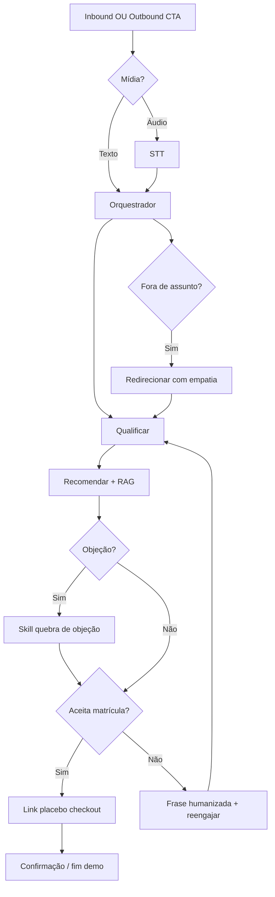

# Fluxo do App — Edu (SDR Prospecção)

> Como o usuário se move pelo produto.
> Fonte: [x] Entrevista com usuário  [ ] Leitura de código existente
> Depende de: [PRD](PRD.md)

**Data**: 2026-11-09

## 1. Perfis de usuário

| Perfil | Descrição | Permissões principais |
|---|---|---|
| Lead (prospect) | Pessoa no WhatsApp (número de teste na demo) interessada em pós/graduação Faveni | Conversar (texto/áudio), receber CTA, aceitar matrícula, abrir link de checkout placebo |
| Operador / time demo | Quem dispara prospecção e observa a conversa | Disparar CTA outbound; ver logs; (CRM depois, se houver tempo) |
| Comprador (cliente Faveni) | Gestor na reunião avaliando o Edu | Interagir como lead de teste; não administra o sistema na demo |

## 2. Jornadas principais

### Jornada A: Inbound — lead solicita atendimento

Perfil: Lead

1. Lead envia mensagem voluntária no WhatsApp de teste (texto ou áudio).
2. Se áudio → STT transcreve → orquestrador classifica intenção e estágio do funil.
3. Edu responde de forma humanizada (texto; **áudio se o lead mandou áudio** e/ou se for momento-chave).
4. Qualificação: já tem graduação? pós ou 2ª licenciatura? área de interesse?
5. Recomendação ancorada no RAG / conhecimento Faveni (1 opção principal + alternativa se fizer sentido).
6. Tratamento de objeção (preço, MEC, tempo, “vou pensar”) via skill dedicada.
7. **Fechamento demo:** lead aceita matrícula → Edu envia **link placebo de checkout/pagamento**.
8. Confirmação: Edu agradece e resume próximo passo (atmosfera de matrícula concluída).

Telas envolvidas: WhatsApp (obrigatório); CRM web (opcional, se sobrar tempo).  
Fluxo de erro/exceção:
- Fora de assunto / pedido que não é venda → **frase humanizada de redirecionamento** de volta ao funil (não recusar como robô).
- STT/TTS falha → responde em texto e segue o funil.
- RAG sem chunk → não inventa; responde com base fixa (R$ 69,90, diferenciais) e avança pergunta.
- Link placebo indisponível → Edu confirma matrícula por mensagem e promete link em seguida (fallback texto).

### Jornada B: Outbound — CTA assistido + resposta do lead (momento especial)

Perfil: Operador (painel) + Lead (WhatsApp)

1. Operador faz **login** no painel demo.
2. **Importa planilha** (2–3 números na apresentação; foco não é escala).
3. Dá um **norte** (brief) → IA gera **CTA** com o conhecimento da empresa (mesmo corpus do Edu); operador revisa.
4. Clica **Enviar** (não há disparo automático ao gerar o CTA).
5. Lead responde → Conversation marcada como `outbound_cta` (momento especial).
6. Edu **entende o CTA enviado**, continua a conversa nesse contexto (não trata como inbound frio).
7. Qualificação → recomendação → objeção → **aceitação de matrícula + link placebo**.

Telas envolvidas: Login · Import · Editor de CTA · Botão Enviar · WhatsApp.  
Fluxo de erro/exceção: sem resposta do lead → sem chase agressivo na demo; falha de envio Evolution → status `error` no recipient.

### Jornada C: Mídia (áudio) — humanização

Perfil: Lead

1. Lead envia áudio → Edu **responde em áudio** (STT → LLM → ElevenLabs).
2. Em **momentos-chave**, mesmo com lead em texto, Edu pode enviar áudio: abertura/reengajamento, quebra de objeção sensível, convite ao fechamento.
3. Demais turnos podem permanecer em texto para velocidade.

Telas envolvidas: WhatsApp.  
Fluxo de erro/exceção: falha ElevenLabs → texto equivalente; nunca travar o funil por voz.

### Critério de fechamento (demo)

> Em produção, o cliente (Faveni) ainda precisa cravar a definição oficial de “venda fechada”.  
> **Na nossa demo:** fechamento = lead **aceita a matrícula** e recebe um **link placebo de checkout** (pagamento simulado). Isso prova condução até o fim sem depender do sistema real deles.

## 3. Diagrama (opcional)

---

## Gaps & Recomendações (preencher só no Modo B — análise de repo existente)

_Não aplicável (Modo A — projeto novo)._
